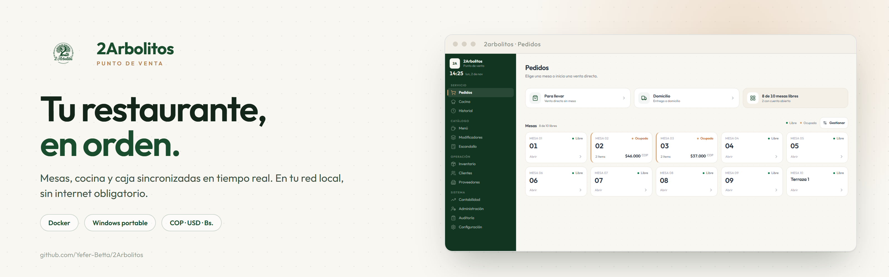

<div align="center">

<picture>
  <source media="(prefers-color-scheme: dark)" srcset="./docs/banner-dark.png">
  
</picture>

**Punto de venta para restaurantes que funciona en tu red local, sin internet obligatorio.**
Mesas, cocina (KDS), caja y multi-moneda en un solo sistema.

[](#portable-windows-x64)
[](#docker-recomendado)

[](https://github.com/Yefer-Betta/2Arbolitos/releases/latest)
[](#licencia-y-documentos-legales)
[](https://github.com/Yefer-Betta/2Arbolitos/releases/latest)
[](https://react.dev)
[](https://www.mysql.com)

</div>

---

## Capturas

<table>
  <tr>
    <td width="50%"><br><sub><b>Pedidos</b> — mesas en vivo, totales por cuenta</sub></td>
    <td width="50%"><br><sub><b>Cocina</b> — tablero con pendientes, en curso y listos</sub></td>
  </tr>
  <tr>
    <td><br><sub><b>Pedido</b> — catálogo, carrito y cobro en una pantalla</sub></td>
    <td><br><sub><b>Menú</b> — productos, categorías y precios en COP/USD</sub></td>
  </tr>
  <tr>
    <td><br><sub><b>Caja</b> — ventas por método de pago, gastos y cierre</sub></td>
    <td><br><sub><b>Móvil</b> — desde el celular, por QR y sin instalar nada</sub></td>
  </tr>
</table>

---

## Lo esencial

| | |
|:--|:--|
| **Mesas en tiempo real** | Estados libre/ocupada, tiempo de atención y total por mesa. Se crean, renombran y desactivan sin tocar la base. |
| **Cocina sin papeles** | Tablero KDS con columnas *Pendiente → Preparando → Listo* que se actualiza solo. |
| **Caja y cierre Z** | Ventas por método de pago, gastos del turno, arqueo y cierre de caja. |
| **Multi-moneda** | COP, USD y bolívares con tasa configurable y vuelto calculado. |
| **Menú y categorías** | Productos, modificadores, precios en USD opcionales y agrupación por categoría. |
| **Sin internet** | Opera en la red local; la PWA guarda una copia de trabajo y sincroniza al volver. |
| **Roles y permisos** | Admin, Gerente, Cajero, Mesero y Cocina, con permisos por rol y baja reversible. |
| **Actualización con un clic** | El panel de Windows consulta la última release y la instala sin tocar tus datos. |

---

## Instalar

### Docker (recomendado)

Requisito: **Docker Desktop** en Windows, macOS o Linux.

```batch
git clone https://github.com/Yefer-Betta/2Arbolitos.git
cd 2Arbolitos
instalar.bat
```

`instalar.bat` abre un instalador visual (PowerShell + WPF, sin dependencias extra) que valida Docker, detecta la IP de la red, genera los secretos, abre el puerto en el firewall, construye las imágenes, arranca los contenedores y verifica el login. Al terminar deja un acceso directo **2Arbolitos POS** en el escritorio.

Si la ventana no abre, el mismo instalador corre en consola:

```batch
instalar.bat /consola
```

**Uso diario:** `iniciar.ps1` para iniciar, detener, reiniciar, ver el QR o el estado. **Estado y respaldos:** `Panel.bat`.

<details>
<summary><b>Problemas que el instalador corrige solo</b></summary>

- Contenedores de un intento anterior → los elimina y reintenta.
- `.env` ausente, con BOM, claves repetidas o secreto por defecto → lo reescribe conservando lo válido (deja `.env.bak`).
- Contenedores con configuración vieja → los recrea para que lean el `.env` actual.
- Contraseña de la base distinta a la del volumen → reutiliza la anterior **sin borrar datos**.
- Puerto 80 ocupado → avisa y permite elegir otro.
- Docker Desktop cerrado → intenta abrirlo y espera al motor.
- IP local cambiada → actualiza `HOST_IP` para los QR.
- Regla de firewall ausente → la vuelve a crear.

</details>

Si ya está configurado, basta con:

```bash
docker compose up -d      # iniciar
docker compose down       # detener
```

### Portable Windows x64

Sin Docker. Requisito único: **MySQL 8 o MariaDB 10.4+** en la misma máquina.

1. Descarga el [ZIP de la última release](https://github.com/Yefer-Betta/2Arbolitos/releases/download/v1.1.4/2Arbolitos-Portable-Windows-x64-1.1.4.zip).
2. Descomprime y abre `start.bat`.
3. La primera vez pide los datos de MySQL, crea la base, corre el seed y abre el navegador en `http://localhost:3002`.

El paquete incluye Node.js embebido, el frontend compilado y el backend con sus dependencias: no hay que instalar Node ni compilar nada. En arranques siguientes detecta los datos y no vuelve a tocar la base.

> El ZIP lo genera GitHub Actions al publicar un tag `v*`. Para generarlo tú mismo: `npm run pack:portable`.

---

## Panel de control (Windows)

`Panel.bat` abre una ventana con el estado del sistema y las tareas del día a día. Usa PowerShell 5.1 y WPF (incluidos en Windows), así que no requiere Node.js. Funciona en Docker y en portable.

| Sección | Qué hace |
|:--------|:---------|
| **Estado** | Motor Docker, contenedores, `/api/health` y base de datos |
| **Acceso** | URL local, URL de red para celulares, abrir el POS, copiar la URL y ver el QR |
| **Acciones** | Iniciar, detener (con confirmación), reiniciar, abrir Docker Desktop |
| **Actualizar** | Consulta la última release y la aplica con confirmación, conservando `.env`, `logs`, `backups` y datos |
| **Respaldo** | Genera `backups/backup-*.sql` (solo en Docker) |
| **Reparar** | Abre el instalador para diagnosticar y corregir |
| **Diagnóstico** | Revisión completa del entorno, con botón para copiar el resultado |
| **Registro** | Últimas 200 líneas de los contenedores, filtrables por servicio |

> **Actualizar es seguro:** el panel nunca borra el volumen de la base, el `.env` ni los respaldos. Si la versión nueva no trae ZIP portable, avisa y enlaza a la release en lugar de romper la instalación.

---

## Cómo funciona

```text
Celular / tablet / PC  ──►  Nginx (solo Docker)  ──►  Express + Prisma  ──►  MySQL 8
        ▲                          │                        │
        └────── SSE (tiempo real) ─┘                        └── SSE
```

- **Frontend:** React 19 + Vite 7 + Tailwind CSS 4, instalable como PWA.
- **Backend:** Express (ESM) con autenticación JWT en cookie `httpOnly`, rate limiting y Helmet.
- **Tiempo real:** Server-Sent Events; la UI aplica versionado optimista para evitar conflictos entre meseros.
- **Offline:** `syncManager` encola cambios en IndexedDB, reintenta con backoff y sirve catálogo desde caché.
- **Base de datos:** MySQL 8 / MariaDB, 24 modelos Prisma con `utf8mb4`.

---

## Usuarios iniciales

| Rol | Usuario | Contraseña |
|:----|:--------|:-----------|
| Administrador | `admin` | `admin123` |
| Gerente | `gerente` | `waiter123` |
| Cajero | `cajero` | `waiter123` |
| Mesero | `mesero` | `waiter123` |
| Cocina | `cocina` | `cook123` |

> Cambia estas contraseñas el primer día y crea un usuario por empleado.

---

## Estructura

```text
2Arbolitos/
├── src/                         Frontend React (POS, KDS, mesas, menú, caja)
├── server/                      Backend Express + Prisma
│   ├── prisma/                  Esquema, migraciones y seed
│   └── src/                     Rutas, controladores, SSE y middleware
├── scripts/                     CLI, respaldos, panel e instalador
│   ├── panel/                   Panel de control (WPF)
│   └── setup/                   Instalador visual y catálogo de errores
├── docs/                        Banner y capturas del README
├── docker-compose.yml           db + backend + frontend
├── instalar.bat                 Instalación única (auto-eleva a admin)
├── iniciar.ps1                  Uso diario (iniciar/detener/QR)
├── Panel.bat                    Panel de control
└── LICENSE · NOTICE.md · TERMS.md · PRIVACY.md · SECURITY.md
```

La documentación técnica para desarrolladores está en [`AGENTS.md`](./AGENTS.md): arquitectura, comandos, base de datos, empaquetado y despliegue.

---

## Novedades

### v1.1.4 — última

- Titularidad corregida en los documentos legales: persona natural de nacionalidad venezolana residente legalmente en Colombia, sin NIT.
- Aclara cómo se documenta el soporte comercial; el Sistema no emite facturación electrónica.
- Sin cambios de código ni de base de datos: actualizar no toca tus datos.

### v1.1.3

- Documentos legales completados para Colombia: Ley 1581 de 2012, Ley 1480 de 2011, plazos y quejas ante la SIC, obligaciones ante la DIAN.

👉 Historial completo en [Releases](https://github.com/Yefer-Betta/2Arbolitos/releases).

---

## Licencia y documentos legales

**Código bajo licencia MIT** — puedes usar, modificar y distribuir el proyecto conservando el aviso de autoría. La **marca, el logotipo y los íconos no** están cubiertos por la licencia.

| Documento | Contenido |
|:----------|:----------|
| [`LICENSE`](./LICENSE) | Texto completo de la licencia MIT |
| [`NOTICE.md`](./NOTICE.md) | Titularidad, marca, tipografía y licencias de las dependencias |
| [`TERMS.md`](./TERMS.md) | Términos de uso, responsabilidades del operador, soporte y garantías |
| [`PRIVACY.md`](./PRIVACY.md) | Qué datos guarda el sistema, dónde, para qué y por cuánto tiempo |
| [`SECURITY.md`](./SECURITY.md) | Cómo reportar vulnerabilidades y lista de verificación |

> Redactados para **Colombia** (Ley 1581 de 2012 y Ley 1480 de 2011). Son una base lista para usar y no sustituyen la revisión de un abogado.

---

<div align="center">

**Hecho en Colombia. Funciona sin internet.**

[Releases](https://github.com/Yefer-Betta/2Arbolitos/releases) · [Issues](https://github.com/Yefer-Betta/2Arbolitos/issues) · [Seguridad](./SECURITY.md) · [Autor](https://github.com/Yefer-Betta)

</div>
